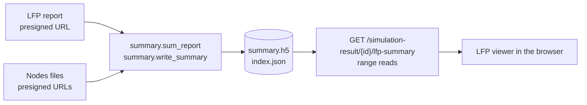

# LFP report summary

A summary holds a simulation's LFP report in the form the web app's LFP viewer reads: one HDF5 file and a JSON index of where its datasets lie in it, so the browser reads any slice with HTTP range requests and no HDF5 library.

It holds the total field, and the field of each group of cells by m-type, e-type, synapse class, layer and region:

- full rows in int16, in blocks of 2^16 steps;
- overview levels at 4 times the steps of the one below, in tiles of 4,096 bins;
- per contact, the statistics, the Welch spectrum in up to 128 bands, and each group's share of the total's variance;
- the correlation of the total between contacts.

A report of 151 GB is a summary of 195.4 MB.

## Who writes and reads it



- **Written by** `summary.sum_report`, which reads the report by range and adds up its cells into the total and the groups, then `summary.write_summary`.
  - `nodes.cell_labels` gives each cell's group, from its population's nodes file.
  - `summary.verify` reads the file back as a browser does before the summary is kept.
- **Read by** the LFP viewer in core-web-app: `src/features/lfp-viewer/summary.ts` reads the format, `use-lfp-summary.ts` fetches it.
- **Read back in Python** with h5py, the blocks' residuals added back up:

  ```python
  import json

  import h5py
  import numpy as np

  from app.core.lfp_summary.summary import undo_residuals

  index = json.load(open("index.json"))
  total = index["axes"][0]
  steps = total["levels"][0]["blocks"]["steps"]
  with h5py.File("summary.h5") as h5:
      stored = h5["lfp/total/rows"][0, 3]
      orders = h5["lfp/total/block_predictors"][0, 3]
  blocks = [undo_residuals(stored[b * steps : (b + 1) * steps], o) for b, o in enumerate(orders)]
  row = np.concatenate(blocks) * total["scales"][0]  # contact 3's total, in µV
  ```

## The pages

| Page | What it holds |
| --- | --- |
| [format.md](format.md) | The specification: the index, the datasets, how a block and a level are read |
| [reader-contract.md](reader-contract.md) | What the browser's reader relies on beyond the specification, and so what a writer change can break |

## Where a summary is built

In Bluenaas, the first time a viewer asks for it. The routes, under `/simulation-result/{result_id}/lfp-summary`, each with the report's `asset` id:

- **`POST`** gives the summary's state, and queues a build where there is neither a summary nor a build. The states are:
  - `ready`, with `size` and `sha256`;
  - `building`, with `queue_position`;
  - `refused`, with `reason`: `not_lfp_report`, `too_large` or `unreadable`;
  - `failed`.
- **`GET`** serves the h5, 206 for a `Range`, `multipart/byteranges` for several. **`GET …/index`** serves the index.
  - Both have the summary's SHA-256 digest as their `ETag`, and answer 412 to an `If-Match` that is not the current summary's.
  - Neither queues a build.
- All three check that the user can read the result and the report first: the cache is shared by everyone. A user's access is kept 60 s, by their token and the project.

A report is summarised where its asset is labelled `lfp_report`, or `voltage_report` with an entry in the simulation's SONATA config of type `lfp`.

The cache, `<STORAGE_PATH>/lfp-summary/e<epoch>/v<version>/<report asset id, split as 1/1/rest>/`:

| File | What it means |
| --- | --- |
| `summary.<hash>.h5` | The summary, written as `summary.h5.<job id>.tmp` and renamed. `<hash>` is its digest's first 16 hex digits |
| `index.<hash>.json` | Its index |
| `summary.json` | Its size, its digest and why it has no groups, if so: which files are current |
| `.ready` | A summary is in, written last |
| `.no-summary` | The report gets no summary in this epoch, and why |
| `.dir-lock` | Held by the build that runs, taken without waiting |

The digest is of the h5 and then the index, so a summary built again with the same h5 and another index has another `ETag`. A new format version is a new directory, so summaries of the version before are built again.

The queues, by the report's size:

| Report | What happens |
| --- | --- |
| up to 1 GiB | A build on `low`, in one worker's share of its task's memory. Over that share, it is moved to `4cpu-16gb` |
| over 1 GiB | A build on `4cpu-16gb` |
| over 1,000 GiB | Refused as `too_large`, nothing queued |

Memory:

- The build holds the total in float64 and peaks at about 3.5 times that, plus 1 GiB, plus 4 bytes a step and contact for each group.
- A total over 2 GiB (steps × contacts × 8 bytes) is refused as `too_large`.
- On `4cpu-16gb`, the axes of groups that don't fit are left out, the one with the most groups first, and the index lists them in `axes_left_out`. A summary that doesn't fit without groups gets `.no-summary` as `too_large`.

A build that fails is retried once, then reported `failed` for an hour. A build whose report URL would expire before it is read is dropped, and the next `POST` queues it with a new one.

## Groups

- **Axes.** `nodes.GROUP_COLUMNS`: `mtype`, `etype`, `synapse_class`, `layer`, `region`.
  - An axis is kept where every population has the column and the cells have two labels or more.
  - Its groups are sorted by name.
- **Nodes files.** The API gives the job a presigned URL for the nodes file of each non-virtual population in the circuit's `circuit_config.json`, so the job carries no token.
- **No groups** for a summed report (`method: sum`), which holds no cell's own field, or a report whose cells are not each on every contact in the order of their ids.
- **A circuit the first reader can't read.**
  - The summary is built without groups, with `groups_unavailable: "circuit_not_readable"`.
  - The next `POST` by someone who can read the circuit queues a `regroup` build, and the summary is read as it is meanwhile.
  - The new summary's files are written under its own hash, then `summary.json` points at them, and the old ones are deleted.
  - A viewer holding the old `ETag` gets 412 and asks for the status again. The viewer asks every minute while `groups_unavailable` is set.

## Why it is so

| Choice | Why |
| --- | --- |
| HDF5 and a JSON index of offsets | The file stays readable with h5py for checks and tests. The browser needs only the offsets and a deflate it already has |
| The index a file of its own | The browser reads it whole first, and it gives every slice's place without reading the h5's metadata |
| int16, at a scale per group | Half the bytes of float32. A step is 1/32767 of the group's peak, 0.01 µV at a peak of 300 µV |
| Rows in blocks of 2^16 steps | A view at full resolution reads only the blocks in its window. A short run is one block |
| A block as residuals of order 0, 1 or 2 | LFP is smooth, so differences deflate smaller. The order is picked per block, whichever deflates smallest |
| Overviews at 4 times the steps, coarsest under 2,048 bins | Any zoom has a level with about one bin a pixel. The coarsest is read whole when the viewer opens |
| Levels in tiles of 4,096 bins | A zoom reads only the tiles in view |
| The total's levels as min and max, a group's as means | Min and max keep the total's peaks. Means of groups add up to the mean of their sum, so the viewer can add groups. Min and max don't add up |
| Chunk tables | A chunked dataset has no one offset, and HDF5's own index of chunks needs a library to read |
| Every chunk written deflated | HDF5 stores a chunk that doesn't shrink raw and flags it, which the browser would have to tell apart |
| Files named by their hash | A rebuild never writes over a file being read. A reader of the old one learns of it by the 412 |
| No copy of the report | Nothing reads it |

## Sizes and times

On the 151 GB report: 216 contacts, 30,000 steps at 10 kHz, 27 fields (the total and 26 groups).

| What | Measured |
| --- | --- |
| Summary | 195.4 MB, against 293.6 MB with the blocks unpredicted and the levels contiguous |
| Build, locally | 54 min at 47 MB/s, 6.0 GiB of memory at most |
| The groups added up | Within 0.08 µV of the total, against an RMS of 105.7 µV |
| A view's 64 rows, on staging | About 1 s in one request, against 12.6 s with a request a row |

## Glossary

| Term | Meaning |
| --- | --- |
| Contact | An electrode the report records the field at |
| Step | One time step of the report, `dt` ms |
| Axis | A way the cells are grouped: `total`, or one of the group columns |
| Group | One label on an axis, such as an m-type. The `total` axis has one group, `total` |
| Field | A group's LFP: the sum over its cells at each contact and step |
| Row | A group's field at one contact, over every step |
| Scale | µV per int16 unit, one per group |
| Block | The unit a row or a level is stored in: one HDF5 chunk, deflated, found by its chunk table |
| Order | The number of times a block's values were taken less the one before |
| Level | The field binned over 2^k steps. Level 0 is the full rows |
| Bin | One value of a level: the min and max, or the mean, of its steps |
| Tile | A block of a level: 4,096 bins of one contact |
| Share | A group's part of the total's variance, at a contact or over all of them |
