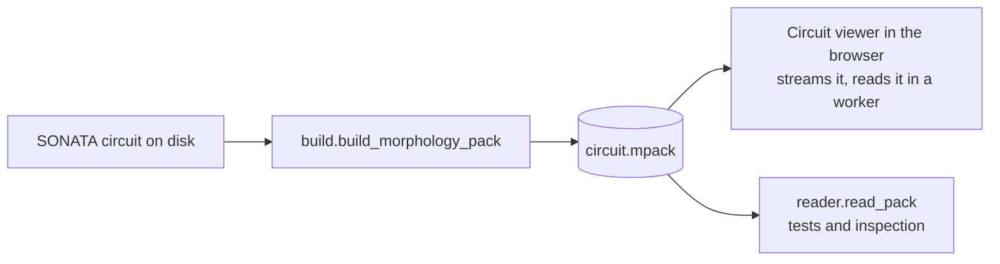

# Circuit morphology pack

A pack holds every biophysical cell's morphology of a circuit in one binary file, ready for a viewer to draw:

- simplified at three levels of detail;
- turned and moved into the circuit's frame;
- cut into cubes of space, each level held as what it adds to the coarser one.

A viewer reads the somas and the coarsest level first and shows the circuit from them. It then reads the finer levels box by box, where the view needs them. A circuit of hundreds of thousands of cells is then one file of tens to hundreds of megabytes instead of a file a morphology.

## Who writes and reads it



- **Written by** `build.build_morphology_pack`, from a SONATA circuit on disk: its config, its node files and its biophysical populations' morphologies, in SWC, ASC or HDF5, as files or a container.
  - It returns the pack's bytes, or raises `NoPackError` with the reason, `PackTooLargeError` where it is over the cap.
  - Bluenaas builds it the first time a viewer asks for it and keeps it in its `morphology-pack` cache: see [Where a pack is built](#where-a-pack-is-built).
- **Read by** the circuit viewer in the browser, which streams the file and reads it in a worker.
- **Read back in Python** by `reader.read_pack`, which the tests hold the writer against. It is also the way to look inside a pack:

  ```python
  from pathlib import Path

  from app.core.morphology_pack.reader import read_pack

  pack = read_pack(Path("circuit.mpack").read_bytes())
  for level in pack.levels:
      print(level.entry.tolerance_um, level.entry.prune_um, len(level.segments))
  ```

## The pages

| Page | What it holds |
| --- | --- |
| [format.md](format.md) | The specification: header, index, blocks, a chunk's streams, what a level holds |
| [reader-contract.md](reader-contract.md) | What the browser's reader relies on beyond the specification, and so what a writer change can break |
| [architecture.md](architecture.md) | The modules, the build from files to bytes, its memory, why the bytes are the same on any number of processes, and what ties the package to OBI-One and Bluenaas |
| [adr/](adr/README.md) | The decisions, one a record, with what was weighed against each |
| [alternatives.md](alternatives.md) | Every option weighed, by area, with what it gave and its verdict |
| [performance.md](performance.md) | Sizes, read and build times, memory and fidelity, as measured |

## Where a pack is built

In Bluenaas, on demand ([ADR 0019](adr/0019-built-on-demand-in-bluenaas.md)):

- **`POST /circuit/{id}/morphology-pack`** gives the pack's state and queues a build when there is neither a pack nor a build. The states are `ready` (with `size` and `sha256`), `building`, `refused` (with `reason`) and `failed`.
- **`GET /circuit/{id}/morphology-pack`** serves the pack once it is ready, 206 for a `Range`, with its SHA-256 digest as the `ETag`. It never queues a build.
- Both check that the user can read the circuit first: the cache is shared by everyone.

The cache, `<STORAGE_PATH>/morphology-pack/e<epoch>/<circuit id>/`:

| File | What it means |
| --- | --- |
| `pack.mpack` | The pack, written as `pack.mpack.<job id>.tmp` and renamed |
| `pack.json` | Its size, SHA-256 digest and the queue that built it |
| `.ready` | The pack and its info are in, written last |
| `.no-pack` | The circuit gets no pack in this epoch, and why |
| `.dir-lock` | Held by the build that runs, taken without waiting |

The queues, by the circuit's `number_neurons`:

| Neurons | What happens |
| --- | --- |
| a single neuron, or over 160,000 | Refused, nothing queued |
| up to 2,000 | A build on `low`, in one worker's share of its task. Over that share, it is moved to `4cpu-16gb` |
| over 2,000 | A build on `4cpu-16gb`, a task to itself. Over the cap, `.no-pack` says too large |

A build that fails is retried once, then reported `failed` for a day. A build whose worker died is failed or retried by the next `POST`, which cleans up the registries of started jobs; its failure callback frees the lock and removes the partial files.

## Glossary

| Term | Meaning |
| --- | --- |
| Grid step | The unit of a position: `gridUm` micrometres, 25 nm. Positions are whole numbers of steps. |
| Radius step | The unit of a radius on a log scale: a radius is `2 ** (step / radiusSteps)` micrometres, 16 steps an octave. |
| Segment | Two points of a cell joined, each with its radius: what a viewer draws as a tube. Named by its far point. |
| Level | The whole circuit at one detail. Each level drops the end branches shorter than its `pruneUm`, then the points within its `toleranceUm` of the path and the diameter. |
| Base | The coarser level a level is read over. The coarsest level, read alone, has none. |
| Inner point | A point of a finer level between the two ends of a base segment it follows. |
| Chord's guess | The guess of an inner point on the straight line to the base segment's far point. Only the miss is stored. |
| Run | Segments one after another along one unbranched polyline of one cell, all ending in one chunk. What a level holds besides what follows its base. |
| Chunk | A cube of `chunkSteps` grid steps, the same at every level; a level's segments in it are one deflated block. |
| Box | A chunk's place, the same at every level. A viewer reads a box at a level once that level's chunk and its bases' are in. |
| Reach | How far a chunk's segments lie outside its cube at most, in grid steps. A reader that culls by cubes grows each one by it. |
| Byte plane | The lowest byte of every number of a stream, then the next byte of every number, and so on: what each stream is stored as before it is deflated. |
| Population boxes | The box of a population's points of each section type at the finest level, which a viewer frames a view by. |

## Limits and settings

| Name | Where | Value | What it sets |
| --- | --- | --- | --- |
| `LEVELS` | `geometry` | 0.125 µm; 0.25 µm; 1 µm with end branches under 5 µm pruned | The levels a pack holds, finest first |
| `GRID_UM` | `codec` | 0.025 | The grid step in micrometres |
| `RADIUS_STEPS` | `codec` | 16 | Radius steps an octave |
| `SMALLEST_RADIUS_UM` | `codec` | 1/1024 | The least radius stored, so that its logarithm is finite |
| `DEFLATE_LEVEL` | `codec` | 6 | zlib's level for every block |
| `PLAIN_DEFLATE_BYTES` | `codec` | 1,024 | Blocks up to this size inflated are deflated whole; larger ones end a deflate block at every byte plane, with `Z_FILTERED` |
| `CHUNK_UM` | `writer` | 50 | The side of a chunk before it is doubled |
| `MAX_CHUNKS` | `writer` | 4,096 | The most chunks a level may have; the side doubles until every level fits |
| `MAX_SEGMENTS` | `build` | 300,000,000 | The most segments over every level a pack may hold, whatever the memory |
| `BASE_BYTES` | `build` | 400 MiB | The build's own memory on two processes, beyond what the process held when it began |
| `BYTES_A_WORKER` | `build` | 128 MiB | What each process past two adds |
| `BYTES_A_SEGMENT` | `build` | 50 | The build's memory a segment over every level |
| `MAX_WORKERS` | `build` | 8 | The most processes a build runs over |
| `MORPHOLOGIES_A_JOB` | `circuit` | 4 | Morphologies simplified in one job of the pool |
| `CHUNKS_A_JOB` | `writer` | 8 | Chunks encoded in one job of the pool |

`segment_cap` turns the memory settings into the most segments a build may hold where it runs:

```
min(MAX_SEGMENTS, (memory left - BASE_BYTES - BYTES_A_WORKER * max(0, processes - 2)) // BYTES_A_SEGMENT)
```

The memory left is the container's cgroup limit, or the machine's memory, less what the process holds. A build whose levels come to more segments than that stops at the first morphology past it, with `PackTooLargeError`, a `NoPackError`.

## What a pack does not hold

- **Section ids.** A segment knows its cell and its section type, not its section or where along the section it lies. Anything addressed by section, such as a synapse's place on a morphology, needs the morphology itself.
- **Every traced point.** The finest level is within 0.125 µm of the trace, in position and in radius.
- **Cells without a morphology that can be read.** They are somas of radius zero, as are cells whose position or rotation is not a finite number.
- **Point neurons and virtual populations.** Only biophysical populations are packed.
